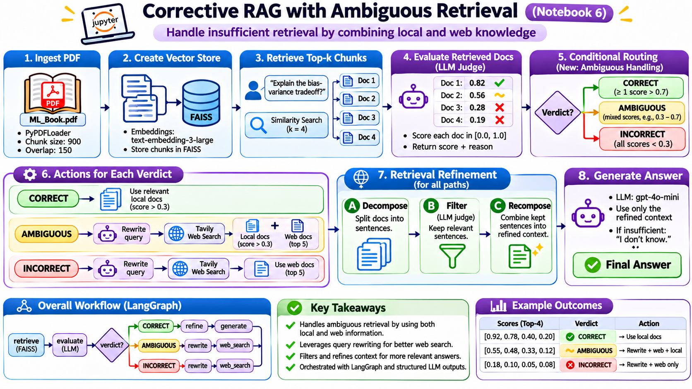

# Corrective Retrieval-Augmented Generation (CRAG)

This project demonstrates Corrective RAG, a retrieval-augmented generation workflow that evaluates retrieved evidence before answering. When local documents provide strong, relevant context, the system refines that evidence and generates a grounded response. When retrieval is weak or uncertain, it can rewrite the question, search the web with Tavily, and refine the resulting evidence before answering.

The notebooks build the workflow step by step, from basic RAG and retrieval refinement to evaluation, web search, query rewriting, ambiguity handling, and the integrated CRAG pipeline. The final implementation uses LangGraph to coordinate retrieval, evaluation, routing, refinement, and answer generation.

Configure the required API credentials in a local `.env` file before running the notebooks. Keep `.env` out of version control.

Reference: [Corrective RAG paper](https://arxiv.org/pdf/2401.15884).