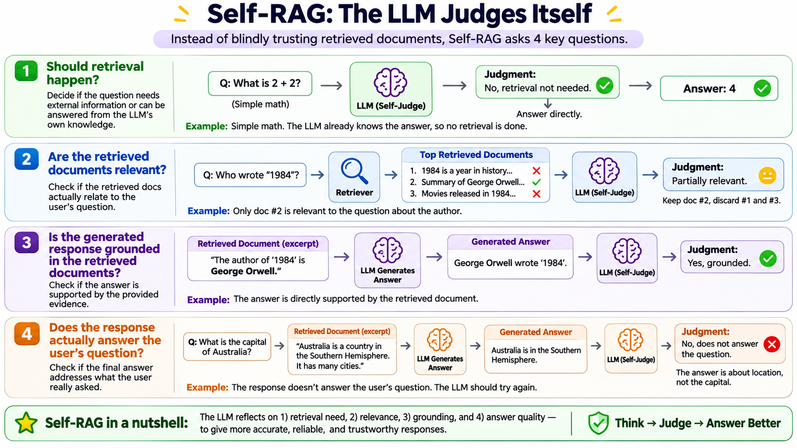

# Self-Reflective RAG

This project demonstrates Self-Reflective Retrieval-Augmented Generation (Self-RAG), a workflow that evaluates its own retrieval and generated answers to improve grounding and relevance. Built with LangGraph, LangChain, FAISS, and an OpenAI chat model, it uses company policy and profile documents as its knowledge base.

The final workflow decides whether a question needs retrieval, searches and filters relevant documents, and generates an answer from the selected evidence. It then checks whether the answer is supported by that evidence. Unsupported answers can be revised, while answers judged unhelpful trigger a rewritten retrieval query and another search attempt, subject to retry limits. General questions can be answered directly without retrieval.

The `self_rag_step1.ipynb` through `self_rag_step6.ipynb` notebooks build these capabilities incrementally. `self_rag_final.ipynb` combines the main workflow, and `self_rag_web.ipynb` explores a web-search variant.

## Setup

Install the packages listed in `requirements.txt`, configure the required API credentials in a local `.env` file, and run the notebooks from the project directory so their relative document paths resolve. Do not commit `.env` or other secrets.