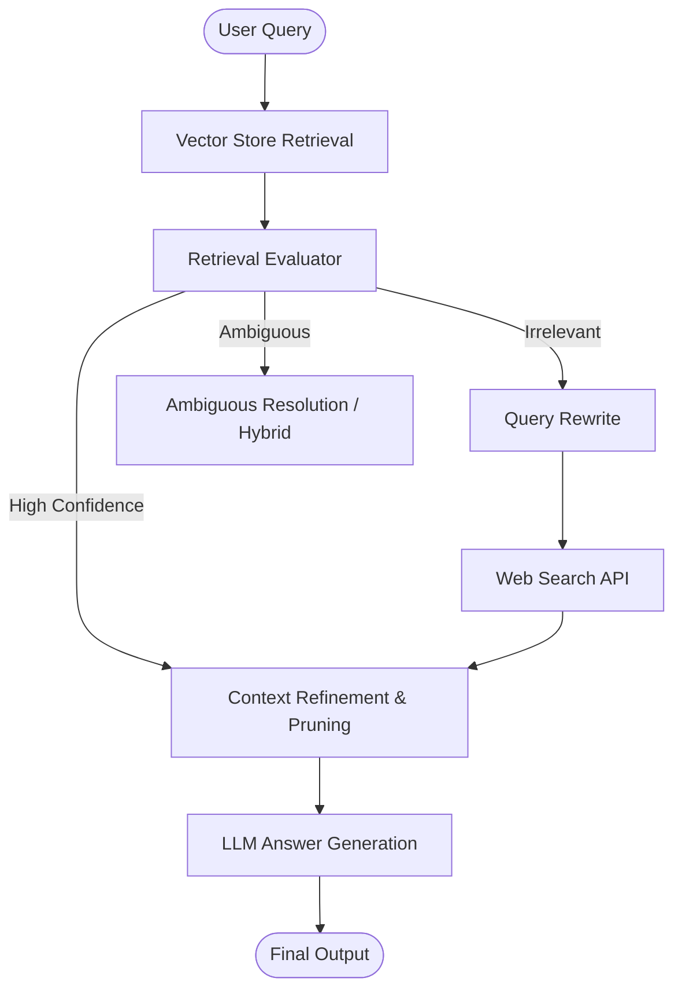

# Advanced & Production RAG Architectures

A comprehensive, hands-on repository exploring modern Retrieval-Augmented Generation (RAG) paradigms — progressing from naive baselines to self-correcting agentic workflows (**Corrective RAG / CRAG**), **Graph RAG**, and production-grade architectures.

---

## Overview

Standard RAG architectures often suffer from hallucinations, retrieval noise, and out-of-date internal knowledge. This repository documents implementations and design patterns aimed at making RAG reliable, token-efficient, and production-ready.

### Key Paradigms Covered
- **Baseline RAG**: Chunking strategies, embedding pipelines, and vector similarity search.
- **Corrective RAG (CRAG)**:
  - Chunk-level relevance scoring and threshold routing (`CORRECT`, `INCORRECT`, `AMBIGUOUS`).
  - Sentence-level context refinement (Decompose $\rightarrow$ Filter $\rightarrow$ Recompose).
  - Web-search fallback integration (via Tavily) for out-of-domain queries.
  - Dynamic query rewriting for optimal web search results.
- **Graph RAG & Agentic RAG**: State machine orchestration using **LangGraph** for dynamic branching and cyclical decision-making.
- **Production Best Practices**: Context pruning, fallback strategies, and latency/token optimization.

---

## Architecture: Corrective RAG (CRAG)



---

## 📂 Repository Structure

```text
├── 1_basic_rag.ipynb                 # Naive RAG baseline (FAISS + Vector Search)
├── 2_retrieval_refinement.ipynb      # Chunk filtering and sentence-level refinement
├── 3_retrieval_evaluator.ipynb       # Chunk relevance grading with confidence thresholds
├── 4_web_search_refinement.ipynb     # CRAG web fallback + web snippet refinement
├── 5_query_rewrite.ipynb             # Query transformation for search engines
├── 6_ambiguous.ipynb                 # Handling uncertain retrieval states
├── final_CRAG.ipynb                  # End-to-end compiled LangGraph CRAG pipeline
├── documents/                        # Sample source PDFs & documents
├── requirements.txt                  # Python dependencies
└── .env.example                      # Template for API keys
```

---

## 🛠️ Tech Stack

- **Orchestration**: [LangGraph](https://github.com/langchain-ai/langgraph), [LangChain](https://github.com/langchain-ai/langchain)
- **Models**: OpenAI (`gpt-4o-mini`, `text-embedding-3-large`), Hugging Face Embeddings
- **Vector Database**: [FAISS](https://github.com/facebookresearch/faiss)
- **Search Tooling**: [Tavily Search API](https://tavily.com/)
- **Data & Parsing**: `PyPDFLoader`, `RecursiveCharacterTextSplitter`

---

## Getting Started

### 1. Clone the repository
```bash
git clone https://github.com/your-username/advanced-rag-architectures.git
cd advanced-rag-architectures
```

### 2. Set up environment
```bash
python -m venv .venv
source .venv/bin/activate  # On Windows: .venv\Scripts\activate
pip install -r requirements.txt
```

### 3. Configure environment variables
Create a `.env` file in the root directory:
```env
OPENAI_API_KEY=your_openai_api_key
TAVILY_API_KEY=your_tavily_api_key

# Optional (if using proxy or custom endpoint)
# BASE_URL=https://your-custom-base-url/v1
```

### 4. Run the notebooks
Launch Jupyter Lab or VS Code and step through the notebooks sequentially:
```bash
jupyter lab
```

---

## Roadmap

- [x] Basic RAG baseline
- [x] Corrective RAG (CRAG) workflow with LangGraph
- [x] Sentence-level refinement & web search fallback
- [ ] Graph RAG (Knowledge Graph entity extraction & graph traversal)
- [ ] Evaluation framework (RAGAS / DeepEval integration)
- [ ] Production API deployment (FastAPI + Docker)

---

## 📄 License
This project is open-source under the [MIT License](LICENSE).
